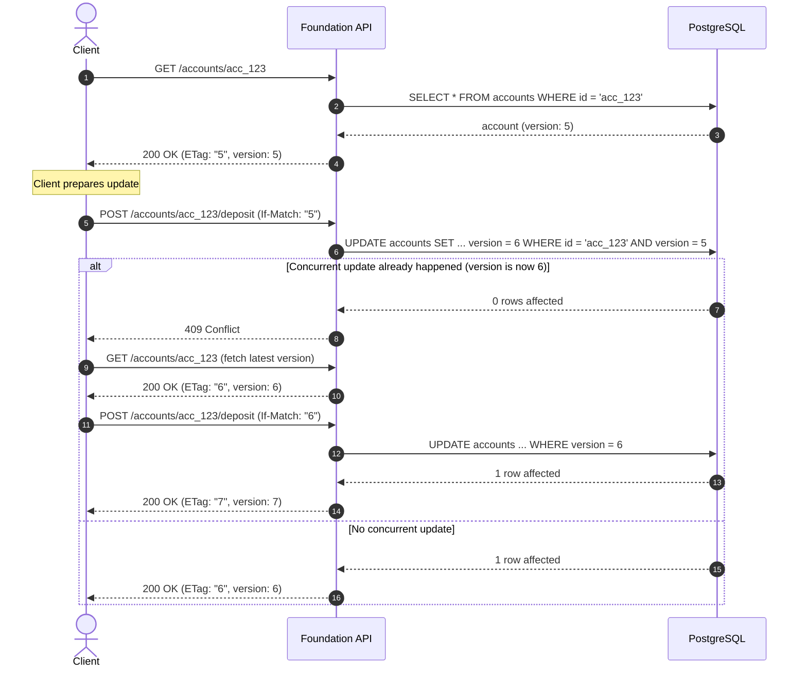

# Optimistic Concurrency Control (OCC)

Pessimistic database locks (`SELECT FOR UPDATE`) can cause bottlenecks and deadlocks in distributed systems.
Foundation provides **Optimistic Concurrency Control (OCC)** through the `@version` field trait, conditional SQL updates, and HTTP `ETag` headers.

---

## 1. Declaring Versioned Entities

To enable OCC on an entity, annotate an integer field with `@version`:

```fdn
entity Account {
  id: string
  owner_id: string
  balance: int
  version: int @version
}

error AccountConflict {
  kind: conflict
  message: "The account was modified by another concurrent transaction"
}

action DepositMoney(account_id: string, amount: int, expected_version: int) -> Account
  @transactional
  @http(method: POST, path: "/accounts/{account_id}/deposit")
{
  let account = get Account where id == account_id or fail AccountNotFound
  account.balance = account.balance + amount
  save account
  return account
}
```

### Compiler Rules for `@version`

- You can annotate only **one** field per entity with `@version`.
- The field must have type `int`.
- When the runtime saves an entity, the runtime increments the version counter automatically.

---

## 2. Storage Engine Execution

When saving a versioned entity, the repository runs a conditional update rather than an unconditional update:

### SQL Dialect (PostgreSQL and SQLite)

```sql
UPDATE accounts
SET balance = $1, version = version + 1
WHERE id = $2 AND version = $3;
```

### Check Affected Rows

The generated Go and TypeScript runtimes check modified row counts:

```go
result, err := tx.ExecContext(ctx, query, account.Balance, account.ID, account.Version)
if err != nil {
    return err
}
rowsAffected, err := result.RowsAffected()
if rowsAffected == 0 {
    // Another worker modified the record between read and save
    return ErrConcurrencyConflict
}
```

If `rowsAffected == 0`, the runtime returns a domain error with kind `conflict`.
If you declare a custom conflict error (such as `AccountConflict`), the runtime returns that error directly.

---

## 3. HTTP Transport Integration (`ETag` and `If-Match`)

Foundation connects OCC directly to HTTP transport standards:

### Reading an Entity (`GET`)

When an HTTP `GET` endpoint returns a versioned entity:
- The HTTP adapter reads the `@version` field and returns it in an `ETag` header:

```http
HTTP/1.1 200 OK
Content-Type: application/json
ETag: "5"

{
  "id": "acc_123",
  "owner_id": "usr_abc",
  "balance": 1500,
  "version": 5
}
```

### Mutating an Entity (`PUT` / `POST` / `PATCH`)

Clients supply the expected version in the JSON payload or through the HTTP `If-Match` header:

```http
POST /accounts/acc_123/deposit HTTP/1.1
Host: api.example.com
Content-Type: application/json
If-Match: "5"

{
  "amount": 200
}
```

If a concurrent transaction updated the account version, the server rejects the request with HTTP `409 Conflict`:

```http
HTTP/1.1 409 Conflict
Content-Type: application/json

{
  "error": "AccountConflict",
  "message": "The account was modified by another concurrent transaction"
}
```

---

## 4. Client Reconciliation Workflow

This diagram shows the standard client workflow for handling OCC conflicts:



---

## 5. Combining OCC with Tactical Traits

- **OCC with `@transactional`**: The version check occurs inside the active database transaction. If `rowsAffected == 0`, the runtime rolls back the transaction immediately.
- **OCC with `@idempotent`**: When a client retries after receiving HTTP 409, the idempotency layer distinguishes duplicate requests from concurrent mutation conflicts.
- **OCC with `@outbox`**: When an update fails because of a version conflict, the runtime writes no outbox events because the transaction rolls back.
