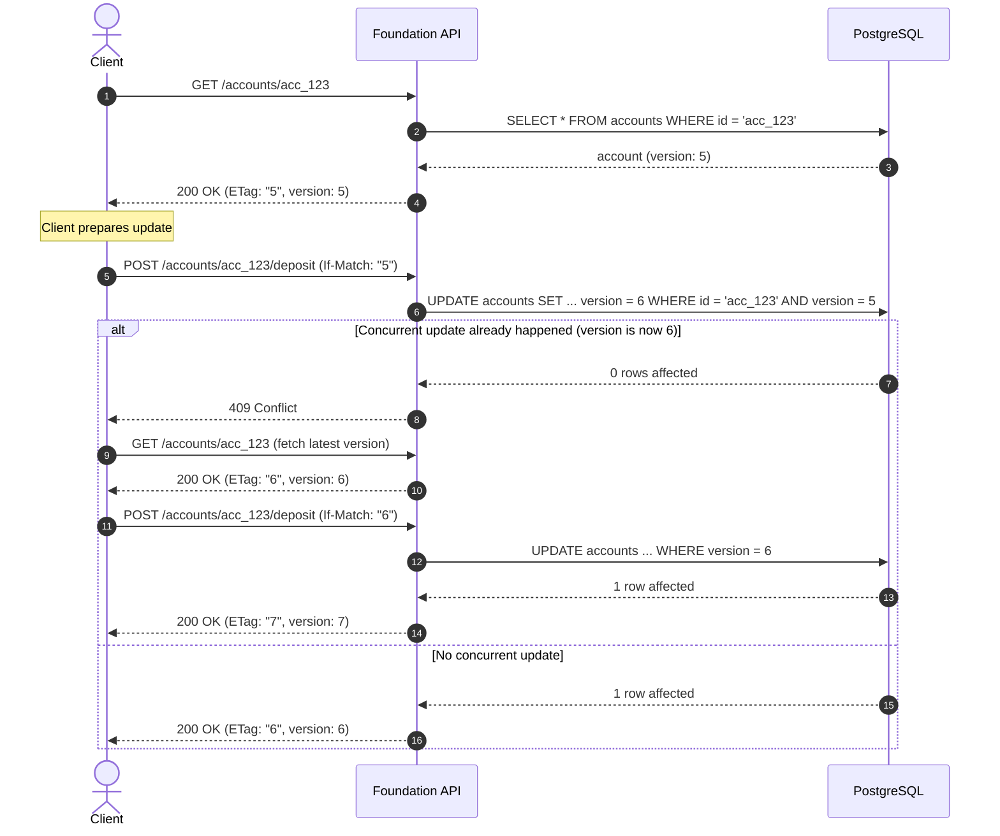

# Optimistic Concurrency Control (OCC)

In distributed and high-throughput systems, pessimistic database locks (`SELECT FOR UPDATE`) can create bottlenecks and deadlocks. Foundation provides first-class support for **Optimistic Concurrency Control (OCC)** using the `@version` field trait, conditional SQL updates, and HTTP `ETag` / `If-Match` headers.

---

## 1. Declaring Versioned Entities

To enable OCC on an entity, annotate an integer field with `@version`:

```fdn
entity Account {
  id: string
  owner_id: string
  balance: int
  version: int @version
}

error AccountConflict {
  kind: conflict
  message: "The account was modified by another concurrent transaction"
}

action DepositMoney(account_id: string, amount: int, expected_version: int) -> Account
  @transactional
  @http(method: POST, path: "/accounts/{account_id}/deposit")
{
  let account = get Account where id == account_id or fail AccountNotFound
  account.balance = account.balance + amount
  save account
  return account
}
```

### Compiler Rules for `@version`
- Exactly **one** field per entity may be annotated with `@version`.
- The field must be of type `int`.
- When an entity is saved, the Foundation compiler automatically synthesizes version increment logic.

---

## 2. Storage Engine Execution

When persisting an entity annotated with `@version`, the generated repository does not execute an unconditional update. Instead, it generates a conditional update:

### SQL Dialect (PostgreSQL & SQLite)
```sql
UPDATE accounts
SET balance = $1, version = version + 1
WHERE id = $2 AND version = $3;
```

### Affected Rows Verification
In the generated Go and TypeScript runtimes:
```go
result, err := tx.ExecContext(ctx, query, account.Balance, account.ID, account.Version)
if err != nil {
    return err
}
rowsAffected, err := result.RowsAffected()
if rowsAffected == 0 {
    // Another worker modified the record between read and save
    return ErrConcurrencyConflict
}
```
If `rowsAffected == 0`, the runtime returns a domain error with kind `conflict`. If a custom error with `kind: conflict` is declared (like `AccountConflict`), it is returned directly.

---

## 3. HTTP Transport Integration (`ETag` and `If-Match`)

Foundation connects OCC directly to HTTP transport standards:

### Reading an Entity (`GET`)
When returning a versioned entity via an HTTP `GET` endpoint:
- The HTTP adapter extracts the `@version` field and emits it as an `ETag` header:
```http
HTTP/1.1 200 OK
Content-Type: application/json
ETag: "5"

{
  "id": "acc_123",
  "owner_id": "usr_abc",
  "balance": 1500,
  "version": 5
}
```

### Mutating an Entity (`PUT` / `POST` / `PATCH`)
Clients can supply the expected version either in the JSON payload or via the standard HTTP `If-Match` header:
```http
POST /accounts/acc_123/deposit HTTP/1.1
Host: api.example.com
Content-Type: application/json
If-Match: "5"

{
  "amount": 200
}
```
If another transaction updated the account to version 6 in the meantime, the server rejects the request with HTTP `409 Conflict`:
```http
HTTP/1.1 409 Conflict
Content-Type: application/json

{
  "error": "AccountConflict",
  "message": "The account was modified by another concurrent transaction"
}
```

---

## 4. Client Reconciliation Workflow

The standard client workflow for handling OCC conflicts:



---

## 5. Combining OCC with Tactical Traits

- **OCC + `@transactional`**: The version check occurs within the active transaction. If `rowsAffected == 0`, the transaction rolls back immediately.
- **OCC + `@idempotent`**: If a client retries with the same idempotency key after receiving a 409, the idempotency layer correctly distinguishes between duplicate requests and concurrent mutation conflicts.
- **OCC + `@outbox`**: If an update fails due to a version conflict, no outbox events are written because the transaction rolls back.
